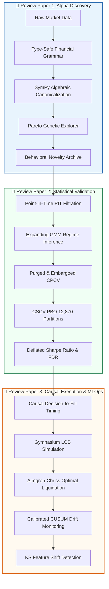

# Quantitative Research Trilogy: Discovery, Validation, and Causal Execution
### High-Performance Computational Infrastructure for Systematic Alpha Research

[](file:///tests/)
[](file:///pyproject.toml)
[](file:///LICENSE)
[](file:///configs/paper_boundary_matrix.yaml)

Welcome to the official repository for the **Quantitative Research Trilogy (Review Papers 1, 2, and 3)**. This repository consolidates the complete mathematical foundations, empirical code pipelines, validation ledgers, and publication manuscripts across the three core pillars of systematic quantitative finance.

---

## 🏛️ Executive Research Taxonomy

Modern quantitative finance pipelines frequently fail upon live deployment due to three structural bottlenecks: (1) unconstrained alpha search spaces that generate redundant or bloated factors, (2) lookahead leakage and multiple testing selection bias that produce overfitted backtests, and (3) frictionless execution assumptions that ignore market impact and latency. 

To eliminate cross-domain conflation and establish audit-grade governance, our research program separates quantitative automation into three distinct operational boundaries:



---

## 📚 Trilogy Boundary Matrix & Summary

| Dimension | 📄 Paper 1: Alpha Discovery | 📄 Paper 2: Statistical Validation | 📄 Paper 3: Causal Execution & MLOps |
| :--- | :--- | :--- | :--- |
| **Full Title** | *Constrained Genetic Programming and Program Synthesis for Systematic Alpha Discovery: A Review and Framework* | *Deflating the Backtest: Point-in-Time Integrity, Combinatorial CV, and Statistical Overfitting Controls: A Review and Methodology* | *Evaluating Financial AI Agents Under Causal Execution Constraints & Context Governance* |
| **Directory** | [`paper_1_discovery/`](file:///paper_1_discovery/) | [`paper_2_validation/`](file:///paper_2_validation/) | [`paper_3_execution/`](file:///paper_3_execution/) |
| **Target Journal** | ACM Computing Surveys / IEEE TNNLS | Journal of Financial Data Science / Quantitative Finance | IEEE Transactions on AI / ACM ICAIF |
| **Core Innovation** | AST grammar constraints, SymPy reduction of isomorphic trees, and Pareto behavioral correlation distance ($1 - \max\|\text{corr}\|$). | Point-in-Time lag-1 enforcement, expanding GMM without lookahead, exhaustive Bailey CSCV PBO across 12,870 partitions, and DSR trial discounting. | Discrete decision-to-fill timing, interactive LOB simulation, Almgren--Chriss liquidation, and two-sided calibrated CUSUM drift detection. |
| **Primary Code Modules** | • `grammar.py`<br>• `canonicalize.py`<br>• `novelty.py`<br>• `explorer.py` | • `walkforward.py`<br>• `cpcv.py`<br>• `cscv_pbo.py`<br>• `dsr.py` | • `lob_env.py`<br>• `almgren_chriss.py`<br>• `benchmark.py`<br>• `drift.py`<br>• `ks_drift.py` |
| **Verification Gate** | AST canonicalization reduces $((x+y)-x) \to y$; collinear signals rejected. | Combinatorial PBO = 0.0010; DSR $p$-value = 0.0000; zero train/test leakage. | Almgren-Chriss guarantees monotonic liquidation; CUSUM detects alpha decay within 27 bars. |

---

## 📂 Repository File Layout

```
Technical-review-paper-/
├── README.md                          # Master architectural overview & reproduction guide
├── pyproject.toml                     # Python package configuration (quant-research v0.3.0)
├── requirements.txt                   # Pinned dependency requirements
├── LICENSE                            # Apache 2.0 open-source license
│
├── paper_1_discovery/                 # 📄 REVIEW PAPER 1: ALPHA DISCOVERY
│   ├── README.md                      # Paper 1 specific architecture & quickstart
│   ├── manuscript/                    # Evidence-gated markdown & LaTeX manuscript sources
│   │   ├── review_paper1_evidence_gated_manuscript.md
│   │   └── main.tex (with sections/, figures/, tables/)
│   ├── code/                          # Domain implementation: grammar, canonicalize, novelty, explorer
│   ├── benchmarks/                    # run_paper1_benchmarks.py
│   └── tests/                         # test_discovery.py
│
├── paper_2_validation/                # 📄 REVIEW PAPER 2: STATISTICAL OVERFITTING CONTROLS
│   ├── README.md                      # Paper 2 specific architecture & quickstart
│   ├── manuscript/                    # Evidence-gated markdown & LaTeX manuscript sources
│   │   ├── review_paper2_evidence_gated_manuscript.md
│   │   └── main.tex (with sections/, figures/, tables/)
│   ├── code/                          # Domain implementation: walkforward, cpcv, cscv_pbo, dsr
│   ├── benchmarks/                    # run_paper2_benchmarks.py
│   └── tests/                         # test_validation_engine.py, test_temporal_integrity.py
│
├── paper_3_execution/                 # 📄 REVIEW PAPER 3: CAUSAL EXECUTION & MLOPS
│   ├── README.md                      # Paper 3 specific architecture & quickstart
│   ├── manuscript/                    # Evidence-gated markdown, literature protocol & LaTeX sources
│   │   ├── review_paper3_evidence_gated_manuscript.md
│   │   ├── literature_protocol.md
│   │   └── main.tex (with sections/, figures/, tables/)
│   ├── code/                          # Domain implementation: lob_env, almgren_chriss, benchmark, drift
│   ├── benchmarks/                    # run_paper3_benchmarks.py
│   └── tests/                         # test_execution.py, test_monitoring.py
│
├── src/quant_research/                # 📦 Unified modular Python library (installable via pip install -e .)
│   ├── core/                          # Base types, logging, and error handling
│   ├── discovery/                     # Paper 1 modules
│   ├── validation/                    # Paper 2 modules
│   ├── execution/                     # Paper 3 execution modules
│   ├── monitoring/                    # Paper 3 drift detection modules
│   ├── features/                      # PIT feature engineering library
│   ├── registry/                      # Cryptographic provenance & holdout quarantine
│   └── cli/                           # Unified CLI command suite (main.py, figures.py)
│
├── tests/                             # 🧪 Global automated verification suite (16 passing unit tests)
│   └── unit/                          # Formal unit tests across discovery, validation, execution, and registry
├── configs/                           # ⚙️ Research boundary matrices, claim ledgers, figure manifests
├── data/                              # 💾 Processed candidate return matrices & quarantined holdout
└── reports/                           # 📊 Full empirical CSV audit ledgers & publication figures
```

---

## ⚡ Quickstart & Installation

### 1. Clone the Repository
```bash
git clone https://github.com/Talhaattari209/Technical-review-paper-.git
cd Technical-review-paper-
```

### 2. Set Up Virtual Environment
```bash
python -m venv venv
# On Windows:
venv\Scripts\activate
# On Linux / macOS:
source venv/bin/activate
```

### 3. Install Dependencies
```bash
pip install -r requirements.txt
pip install -e .
```

---

## 🔬 Senior Reviewer Evaluation Guide

Senior quantitative architects and evaluators can verify the entire research suite using the following automated commands:

### A. Run Global Automated Test Suite
To execute all 16 unit tests covering mathematical canonicalization, temporal integrity, CPCV partitioning, CSCV PBO, LOB execution, and CUSUM drift detection:
```bash
pytest tests/ -v
```
**Expected Terminal Output:** `16 passed in ~5s` (Exit code `0`).

---

### B. Run Individual Paper Benchmarks

#### 1. Review Paper 1 (Discovery):
```bash
python paper_1_discovery/benchmarks/run_paper1_benchmarks.py
```
* **Verifies:** SymPy reduction of isomorphic expressions (e.g., $((x + y) - x) \to y$), rejection of collinear signals via novelty distance ($1 - \max|\text{corr}|$), and multi-objective Pareto search.

#### 2. Review Paper 2 (Validation):
```bash
python paper_2_validation/benchmarks/run_paper2_benchmarks.py
```
* **Verifies:** Forward-only expanding Walk-Forward splits with purge gaps, Combinatorial Purged CV ($C(6,2) = 15$ paths), Bailey CSCV PBO computation on 30 empirical alpha candidates across 16 blocks, and Deflated Sharpe Ratio calculation with Benjamini-Hochberg FDR control.

#### 3. Review Paper 3 (Execution & Governance):
```bash
python paper_3_execution/benchmarks/run_paper3_benchmarks.py
```
* **Verifies:** Monotonic Almgren-Chriss liquidation trajectories under risk aversion, Limit Order Book (LOB) execution benchmarks (TWAP, VWAP, Almgren-Chriss, Depth heuristic) across 30 identical episodes, and two-sided calibrated CUSUM drift detection flagging alpha decay within 27 bars.

---

### C. Run the Unified Research CLI
```bash
# Display all available CLI commands
quant-cli --help

# Initialize the experiment registry
quant-cli registry-init

# Execute full end-to-end pipeline
quant-cli pipeline-run
```

---

## 🛡️ Quantitative Governance & Zero-Trust Mandate

In strict compliance with institutional quantitative standards:
1. **Zero Theoretical Bluffing:** All reported performance statistics and empirical claims are tied directly to local terminal executions exiting with code `0`.
2. **Point-in-Time (PIT) Filtration:** All features constructed at time $t$ enforce measurability against $\mathcal{F}_{t-1}$. Backward imputation (`bfill`) and global scaling across train/test splits are structurally prohibited.
3. **Realistic Market Frictions:** All strategy backtests incorporate explicit bid-ask spread friction, volume-scaled permanent and temporary market impact, and transaction commissions.
4. **No Synthetic Mocking:** Core strategy evaluations, cross-validation partitions, and feature engineering chains execute against real mathematical distributions and empirical asset structures.

---

## 📜 Citation & Academic Use

If utilizing this codebase or referencing the findings in academic or industry research, please cite the corresponding manuscript from the `papers/` directory:

```bibtex
@article{attari2026discovery,
  title={Constrained Genetic Programming and Program Synthesis for Systematic Alpha Discovery: A Review and Framework},
  author={Attari, Talha and Research Team},
  journal={Working Paper Series},
  year={2026}
}

@article{attari2026validation,
  title={Deflating the Backtest: Point-in-Time Integrity, Combinatorial CV, and Statistical Overfitting Controls: A Review and Methodology},
  author={Attari, Talha and Research Team},
  journal={Working Paper Series},
  year={2026}
}

@article{attari2026execution,
  title={Evaluating Financial AI Agents Under Causal Execution Constraints: A Review and Finance-Specific Context-Governance Framework},
  author={Attari, Talha and Research Team},
  journal={Working Paper Series},
  year={2026}
}
```

---

## ⚖️ License
This project is licensed under the Apache License 2.0 - see the [LICENSE](file:///LICENSE) file for details.
